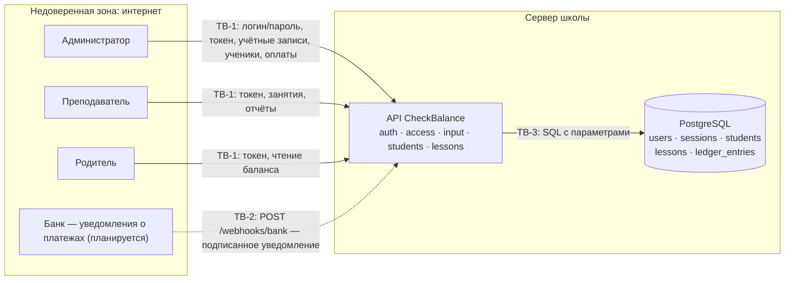

# Модель угроз

[Паспорт](../PROJECT.md) · [Требования](requirements.md) · [Решения](design-decisions.md)

## Модель продукта

**Что уже существует:** API с модулями `auth`, `access`, `input`, `students`, `lessons`; таблицы `users`, `sessions`, `students`, `lessons`, `ledger_entries`; ручное зачисление оплаты администратором.

**Что пока планируется:** endpoint уведомлений банка `POST /webhooks/bank` и сверка с выпиской ([D-04](design-decisions.md#d-04)); ограничение частоты попыток входа.

**Существенные допущения:**

- API работает за HTTPS-прокси (TLS терминируется на нём); токены не передаются по открытому каналу. В локальном запуске HTTP допустим.
- PostgreSQL доступна только серверу (порт открыт на 127.0.0.1 / во внутренней сети compose); учётные данные БД — из окружения, не из репозитория.
- Администратор доверен в пределах своих действий, но не должен иметь возможности отчитываться за преподавателя и незаметно править денежный журнал.
- Преподаватель — частично доверенный внутренний пользователь: его заработок зависит от числа отчитанных занятий, и у него есть мотив увести семью напрямую. Поэтому преподаватель рассматривается как возможный нарушитель.

## Границы доверия

| Граница | Что пересекает | Почему требуется проверка |
| --- | --- | --- |
| TB-1. Клиент ↔ API | Логин и пароль, токен сессии, идентификаторы учеников и занятий, суммы, статусы отчётов | Клиент полностью управляет запросом: может подставить чужой id, лишние поля, повторить запрос, украсть или переиграть токен |
| TB-2. Банк ↔ API (планируется) | Уведомление о платеже: номер операции, сумма, плательщик | Endpoint доступен из интернета; запрос с тем же форматом может отправить кто угодно, легитимный банк повторяет доставку |
| TB-3. API ↔ PostgreSQL | SQL-запросы, хеши паролей и токенов, денежный журнал | Ошибка приложения или внедрение SQL меняет деньги напрямую; утечка БД не должна давать готовых токенов и паролей |

## Значимые объекты и свойства

См. [паспорт, раздел 5](../PROJECT.md#5-значимые-данные-и-другие-объекты). Главные свойства: целостность денежного журнала, конфиденциальность контактов родителя и денег от преподавателя, подлинность субъекта запроса.

## Угрозы

Шкала приоритета: **высокий** — прямой ущерб деньгам или персональным данным в основном сценарии и реалистичный нарушитель; **средний** — ущерб ограничен или нужен дополнительный шаг; **низкий** — маловероятно при принятых допущениях.

**T-01. Использование чужой или отозванной сессии.** Токен утёк (общий компьютер, лог прокси, сохранённый в браузере) и используется после выхода владельца или после его увольнения; либо клиент передаёт в теле запроса поле `role` или `user_id`, рассчитывая выполнить действие от чужого имени.
- Нарушается: подлинность субъекта, все данные пользователя.
- Граница: TB-1, любой защищённый endpoint.
- Связанные SR: [SR-01](requirements.md#sr-01), [SR-02](requirements.md#sr-02).
- Приоритет: **высокий** — компрометация любой роли открывает её полномочия; утечка токенов — частый сценарий для веб-сервисов.

**T-02. Подбор пароля и перечисление логинов.** Нарушитель перебирает пароли к `/auth/login` или по различию ответов узнаёт, какие логины существуют.
- Нарушается: конфиденциальность учётных записей.
- Граница: TB-1, `POST /auth/login`.
- Связанные SR: [SR-04](requirements.md#sr-04).
- Приоритет: **средний** — пароли от 10 символов и argon2id замедляют перебор; ограничение частоты пока не реализовано, поэтому риск остаётся.

**T-03. Доступ к чужому ученику подстановкой id (IDOR).** Родитель или преподаватель подставляет в путь id чужого ученика или занятия: читает чужой баланс и историю, создаёт занятие чужому ученику или отчитывается по чужому занятию и списывает деньги с чужого баланса.
- Нарушается: конфиденциальность денег, целостность чужого баланса.
- Граница: TB-1, `/students/{id}`, `/students/{id}/ledger`, `/lessons`, `/lessons/{id}/report`.
- Связанные SR: [SR-05](requirements.md#sr-05).
- Приоритет: **высокий** — идентификаторы видны в ответах и ссылках; ошибка в одной проверке открывает все объекты этого типа.

**T-04. Раскрытие контактов родителя и денег преподавателю.** Преподаватель получает телефон родителя или цену и баланс из ответа API — в том числе из «лишних» полей ответа, которые интерфейс просто не показывает, — и договаривается с семьёй напрямую в обход школы.
- Нарушается: конфиденциальность персональных данных и коммерческой информации школы.
- Граница: TB-1, ответы `GET /students`, `GET /students/{id}`.
- Связанные SR: [SR-06](requirements.md#sr-06).
- Приоритет: **высокий** — для онлайн-школы это реальный и регулярный сценарий потери клиентов, нарушитель — легальный пользователь с действующей сессией.

**T-05. Двойное списание за одно занятие.** Преподаватель дважды нажимает «Отчитаться», клиент повторяет запрос после таймаута, или два запроса приходят одновременно; каждый проходит проверку «ещё не отчитано» и списывает стоимость.
- Нарушается: целостность денежного журнала, деньги родителя.
- Граница: TB-1, `POST /lessons/{id}/report`.
- Связанные SR: [SR-07](requirements.md#sr-07).
- Приоритет: **высокий** — возникает без злого умысла при обычной работе сети; ущерб — прямые деньги родителя и доверие к школе.

**T-06. Ложный отчёт о непроведённом занятии.** Преподаватель отчитывается о будущем занятии или о занятии, которое не проводилось, чтобы увеличить заработок; либо отчёт пишет другой сотрудник, и потом невозможно установить автора.
- Нарушается: целостность журнала, неотказуемость отчёта.
- Граница: TB-1, `POST /lessons/{id}/report`.
- Связанные SR: [SR-08](requirements.md#sr-08).
- Приоритет: **средний** — мотив есть, но ложное «проведено» по прошедшему занятию родитель видит в истории и может оспорить; сервер ограничивает только то, что проверяемо технически.

**T-07. Поддельное уведомление банка о платеже.** Нарушитель узнаёт адрес endpoint уведомлений и отправляет запрос «платёж 50 000 ₽ от телефона родителя», получая бесплатные занятия.
- Нарушается: целостность журнала, деньги школы.
- Граница: TB-2, `POST /webhooks/bank` (планируется).
- Связанные SR: [SR-09](requirements.md#sr-09).
- Приоритет: **высокий** — endpoint по определению открыт в интернет, а без проверки подлинности одного запроса достаточно для ущерба.

**T-08. Повторное зачисление одного платежа.** Банк повторяет доставку уведомления, администратор вносит ту же операцию вручную, или злоумышленник переигрывает перехваченное подписанное уведомление; баланс увеличивается дважды.
- Нарушается: целостность журнала.
- Граница: TB-2, TB-1 (`POST /students/{id}/payments`).
- Связанные SR: [SR-10](requirements.md#sr-10).
- Приоритет: **средний** — повторы доставки штатны для банков, но ущерб ограничен суммой одного платежа и выявляется сверкой.

**T-09. Неоднозначный или вредный ввод.** Запрос с повторным ключом (`"amount": 100, "amount": -500`), лишним полем (`"role": "admin"`), строкой вместо числа, огромным телом или отрицательной ценой приводит к неожиданному изменению денег или к отказу в обслуживании.
- Нарушается: целостность данных, доступность.
- Граница: TB-1, все endpoint с телом.
- Связанные SR: [SR-11](requirements.md#sr-11).
- Приоритет: **средний** — последствия зависят от конкретной ошибки разбора; закрывается дешёвой общей мерой.

**T-10. Утечка секретов из БД, логов или ответов.** Из резервной копии БД, логов или текста ошибки 500 извлекаются пароли, токены или строка подключения к БД.
- Нарушается: конфиденциальность учётных данных.
- Граница: TB-3, ответы API об ошибках.
- Связанные SR: [SR-03](requirements.md#sr-03).
- Приоритет: **средний** — требует доступа к БД или логам, но последствия — компрометация всех пользователей.

## Приоритетный набор

**T-01, T-03, T-04, T-05, T-07.** Все пять дают прямой ущерб деньгам или персональным данным в основных сценариях; нарушитель реалистичен — внешний (T-01, T-07), легальный пользователь другой семьи или преподаватель (T-03, T-04), или обычный сбой сети (T-05).

Остальные угрозы получили средний приоритет: T-02 и T-10 смягчены выбранными мерами хранения секретов; T-06 частично обнаруживается родителем; T-08 ограничен суммой одного платежа; T-09 закрыт общим механизмом разбора. Для них есть SR и проверки, но на защите EK1 подробно разбирается приоритетный набор.

Цепочки приоритетного набора:

| Угроза | Требование | Решение | Где будущая проверка |
| --- | --- | --- | --- |
| T-01 | SR-01, SR-02 | [D-01](design-decisions.md#d-01) | D-01, «Будущая проверка» |
| T-03 | SR-05 | [D-02](design-decisions.md#d-02) | D-02, «Будущая проверка» |
| T-04 | SR-06 | [D-02](design-decisions.md#d-02) | D-02, «Будущая проверка» |
| T-05 | SR-07 | [D-03](design-decisions.md#d-03) | D-03, «Будущая проверка» |
| T-07 | SR-09 | [D-04](design-decisions.md#d-04) | D-04, «Будущая проверка» |
